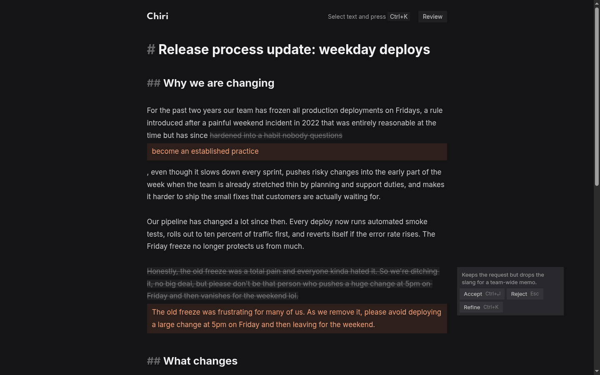

# Desafinado

## What it is

A browser Markdown editor with an AI co-author. Select text, or put the cursor in a paragraph, and ask for a change with `⌘K`: type a Quick action (Shorter, Clearer, Fix grammar) or any free text. The AI answers inline as a tracked change: the old text struck through, the new text beside it, and a one-line Rationale on a card in the margin (on hover when the window is narrow). Small edits show a word-level diff; rewrites show the whole block. You can Accept, Reject, or Refine a Suggestion ("make it shorter", then "now more formal"), and step back to an earlier version with the arrows on its card. A Review pass reads the whole Document, optionally with a Focus ("tone only"), and streams up to six Suggestions, with Accept all and Reject all; when it ends, the cursor lands on the first one in the text. Nothing touches the Document until you Accept, and Accept is a normal edit, so `⌘Z` undoes it. Open loads a `.md` file from disk and Save writes it back (in Chrome and Edge, to the same file; elsewhere, as a download). The Timeline under the header keeps a Version of the whole text after each Accept, Open, Restore and pause in your typing, marked by who made it; click a dot to see that Version against now and Restore it, or open Full history to read how the Document changed, AI Rationales included.

The AI has one visible identity: an "AI" tag in a single color. While it works, its caret travels to the passage it is working on, labeled with your Instruction, and during a Review pass it hops to each Suggestion as it streams in. New text fades in word by word, removed text is struck through as you watch, and accepted text lands in the AI's color before it fades into your own ink. All of it falls back to plain color changes under the system's reduced-motion setting.



## How to run it

Needs Node 22.12 or newer and pnpm (the version is pinned in `packageManager`; `corepack enable` installs it).

```sh
cp .env.example .env     # then set OPENROUTER_API_KEY
pnpm install
pnpm dev                 # open the printed URL
pnpm dev:electron        # or the same app in an Electron window
```

- `OPENROUTER_MODEL` is optional and defaults to `openai/gpt-6.1-terra`.
- An `OPENROUTER_API_KEY` already exported in the shell wins over the one in `.env`: Vite and the scripts read the environment first. Without one in the shell, `.env` is used.
- The key stays on the server side. The browser sends a placeholder, and the Vite proxy (`/api/openrouter/*`) overwrites `Authorization`. `.env` is not committed and the built bundle contains no key ([ADR 0005](docs/adr/0005-local-only-vite-proxy.md)). The app is local only; there is no hosted version.
- Without a key the app opens and shows a banner that says what is missing.
- To try it: the sample Document has an overlong paragraph, a slangy one and a typo. Select one and press `⌘K`.
- On an [Omarchy](https://omarchy.org) machine, `pnpm dev` and `pnpm dev:electron` read the current Omarchy theme (`~/.local/state/omarchy/current/theme/colors.toml`), light or dark, and follow it live when you switch themes. It is one option in **Preferences** (`Ctrl+,`), beside 24 palettes from *A Dictionary of Color Combinations* and the original Desafinado theme; the choice is remembered. Elsewhere, and in built or installed apps, the default is the Mood Indigo palette. See [DESIGN.md](DESIGN.md).

| Command | What it does |
|---|---|
| `pnpm test` | Vitest. Never calls the model. |
| `pnpm biome check` | Lint and format. |
| `pnpm dev:electron` | The app in an Electron window on the Vite dev server, so the proxy and the key work as with `pnpm dev`. `DESAFINADO_DEV_PORT`, `DESAFINADO_CDP_PORT` and `DESAFINADO_USER_DATA_DIR` set its ports and data folder ([AGENTS.md](AGENTS.md)). |
| `pnpm package` | The Electron app as a Linux package (`release/*.pacman`) that runs with no repo, no terminal and no `.env`; the key is set on the app's Key screen. The package opens the `.md` it is given and sends a second one to the open window; `xdg-mime default desafinado.desktop text/markdown text/x-markdown` makes it the default ([ADR 0013](docs/adr/0013-native-app-on-electron.md)). |
| `pnpm build` | Type-check, then the production builds of the Web app (`dist/`) and the Electron app (`out/`). |
| `pnpm bakeoff` | Calls the model: 9 models, 4 Quick actions and a Review pass each, about US$0.056. Rewrites `docs/bakeoff.md`. Needs the key. |

Keys (`Ctrl` instead of `⌘` outside macOS):

| Key | Action |
|---|---|
| `⌘K` | Ask about the selection, or the paragraph under the cursor. Inside a Suggestion: Refine it. |
| `⌘Enter` | Accept the Suggestion under the cursor. |
| `Ctrl+H` / `Ctrl+L` | Inside a Suggestion with more than one version, or on its card's buttons: show the previous / next one (`Ctrl` on macOS too). |
| `Tab` | With the bubble or the Active Suggestion's card open: move into it. `Tab` and `Shift+Tab` then cycle its buttons. |
| `Esc` | Close the bubble or the Refine box; cancel a request or a Refine in flight; on a card button, go back to the text; otherwise Reject the Suggestion under the cursor. |
| `⌘Z` | Undo an Accept, or an Accept all in one step. Reject cannot be undone. |
| `⌘O` | Open a `.md` file. Stops a Review pass and drops open Suggestions; `⌘Z` brings the previous text back. |
| `⌘S` / `⇧⌘S` | Save / Save as. Shift-click on Save is Save as. In Firefox and Safari both download a copy. |
| `←` / `→`, `Home` / `End` | On the Timeline: move between Versions. `Esc` goes back to the editor. |

## With more time

Details and context in [docs/BACKLOG.md](docs/BACKLOG.md).

1. **Undoable Reject.** One stray `Esc` loses a Suggestion for good.
2. **A sturdier Review prompt.** In the Bake-off, moving one sentence made two models return junk Replacements. A guard drops the one shape seen so far, and the prompt still needs a Bake-off re-run after any change.
3. **A size limit for the Review pass.** It sends the whole Document, so cost and latency grow with it and nothing stops a very long one.

## Links

- [Architecture decisions](docs/adr/), [glossary](GLOSSARY.md), [workflow](docs/PLAN.md), [backlog](docs/BACKLOG.md)
- [Bake-off](docs/bakeoff.md): the 9 models that were weighed for the default, side by side
- [Product](PRODUCT.md) and [design](DESIGN.md)
