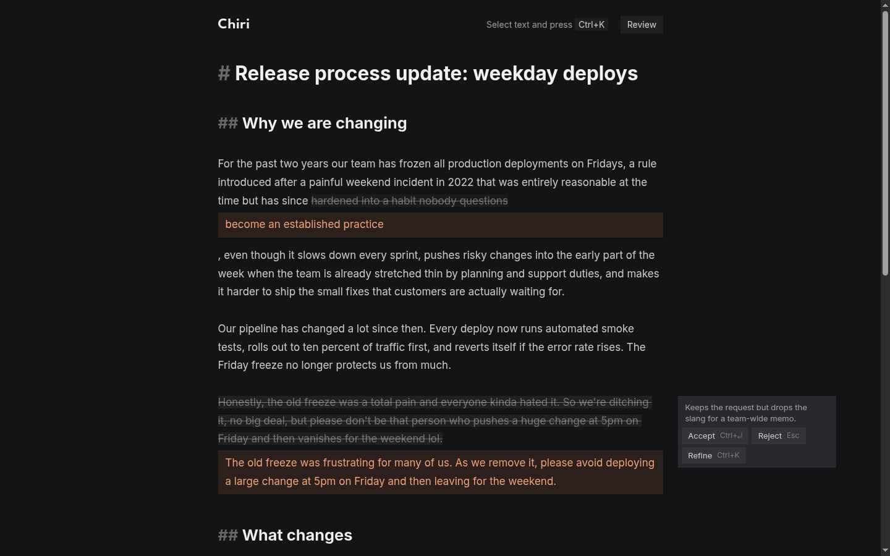

# Chiri AI Editor

## What it is

A browser Markdown editor with an AI co-author. Select text, or put the cursor in a paragraph, and ask for a change with a Quick action (Shorter, Clearer, More formal, Fix grammar), free text, or `⌘K`. The AI answers inline as a tracked change: the old text struck through, the new text beside it, and a one-line Rationale on a card in the margin (on hover when the window is narrow). Small edits show a word-level diff; rewrites show the whole block. You can Accept, Reject, or Refine a Suggestion ("make it shorter", then "now more formal"), and step back to an earlier version with the arrows on its card. A Review pass reads the whole Document, optionally with a Focus ("tone only"), and streams up to six Suggestions, with Accept all and Reject all; when it ends, the cursor lands on the first one in the text. Nothing touches the Document until you Accept, and Accept is a normal edit, so `⌘Z` undoes it. Open loads a `.md` file from disk and Save writes it back (in Chrome and Edge, to the same file; elsewhere, as a download). The Timeline under the header keeps a Version of the whole text after each Accept, Open, Restore and pause in your typing, marked by who made it; click a dot to see that Version against now and Restore it, or open Full history to read how the Document changed, AI Rationales included.



**How it was built.**
- A planning session (Claude Code, `grilling` skill) produced the [ADRs](docs/chiri/adr/), the [glossary](GLOSSARY.md), the [plan](docs/PLAN.md) and six issues.
- An orchestrator session (Claude Code, `opus`) ran the six slices one after another. Each slice had a `sonnet` implementer subagent (tests first for the pure modules, then the UI), a check of the acceptance criteria in a real browser, and a review by `opus` (Standards and Spec) followed by `sonnet` until clean. The maintainer decided at three gates: the model (A), the core flow (B) and this submission (C).
- The default model, `openai/gpt-6.1-terra`, was chosen by a [Bake-off](docs/chiri/bakeoff.md) of 9 models on the same requests (final run US$0.056; about US$0.17 for the three full runs plus the language re-check; about US$0.23 for everything spent on choosing the model, with the prompt checks and probes).
- Every model call made while building was recorded against the US$5 budget in the [AI cost log](docs/chiri/ai-costs.md). The UI has no end-to-end suite; it was checked by hand, and each check is written up in [docs/chiri/verification/](docs/chiri/verification/).
- After the submission, more sessions polished the app, each ending in its own PR: the Chiri palette, a flat UI and keyboard and placement fixes for the AI bubble ([PR #14](https://github.com/walteraandrade/chiri-ai-editor/pull/14)), a clearer backlog ([PR #15](https://github.com/walteraandrade/chiri-ai-editor/pull/15)), margin cards for the Active Suggestion ([PR #16](https://github.com/walteraandrade/chiri-ai-editor/pull/16)), version arrows for Refine ([PR #19](https://github.com/walteraandrade/chiri-ai-editor/pull/19)), the cursor on the first review Suggestion when a pass ends ([PR #20](https://github.com/walteraandrade/chiri-ai-editor/pull/20)) and opening and saving `.md` files ([PR #22](https://github.com/walteraandrade/chiri-ai-editor/pull/22)).

## How to run it

Needs Node 22.12 or newer and pnpm (the version is pinned in `packageManager`; `corepack enable` installs it).

```sh
cp .env.example .env     # then set OPENROUTER_API_KEY
pnpm install
pnpm dev                 # open the printed URL
```

- `OPENROUTER_MODEL` is optional and defaults to `openai/gpt-6.1-terra`.
- An `OPENROUTER_API_KEY` already exported in the shell wins over the one in `.env`: Vite and the scripts read the environment first. Without one in the shell, `.env` is used.
- The key stays on the server side. The browser sends a placeholder, and the Vite proxy (`/api/openrouter/*`) overwrites `Authorization`. `.env` is not committed and the built bundle contains no key ([ADR 0005](docs/chiri/adr/0005-local-only-vite-proxy.md)). The app is local only; there is no hosted version.
- Without a key the app opens and shows a banner that says what is missing.
- To try it: the sample Document has an overlong paragraph, a slangy one and a typo. Select one and press `⌘K`.

| Command | What it does |
|---|---|
| `pnpm test` | Vitest. Never calls the model. |
| `pnpm biome check` | Lint and format. |
| `pnpm build` | Type-check and production build. |
| `pnpm bakeoff` | Calls the model: 9 models, 4 Quick actions and a Review pass each, about US$0.056. Rewrites `docs/chiri/bakeoff.md`. Needs the key. |
| `pnpm export-sessions` | Copies the Claude Code sessions into `ai-sessions/` with OpenRouter keys masked. `--verify` compares the copy with the source. |

Keys (`Ctrl` instead of `⌘` outside macOS):

| Key | Action |
|---|---|
| `⌘K` | Ask about the selection, or the paragraph under the cursor. Inside a Suggestion: Refine it. |
| `⌘Enter` | Accept the Suggestion under the cursor. |
| `Ctrl+H` / `Ctrl+L` | Inside a Suggestion with more than one version, or on its card's buttons: show the previous / next one (`Ctrl` on macOS too). |
| `Tab` | With the bubble or the Active Suggestion's card open: move into it. `Tab` and `Shift+Tab` then cycle its buttons. |
| `Esc` | Close the bubble or the Refine box; cancel a request or a Refine in flight; on a card button, go back to the text; otherwise Reject the Suggestion under the cursor. |
| `⌘Z` | Undo an Accept, or an Accept all in one step. Reject cannot be undone. |
| `⌘O` | Open a `.md` file. Stops a Review pass and drops open Suggestions; `⌘Z` brings the previous text back. |
| `⌘S` / `⇧⌘S` | Save / Save as. Shift-click on Save is Save as. In Firefox and Safari both download a copy. |
| `←` / `→`, `Home` / `End` | On the Timeline: move between Versions. `Esc` goes back to the editor. |

## With more time

Details and context in [docs/BACKLOG.md](docs/BACKLOG.md).

1. **Undoable Reject.** One stray `Esc` loses a Suggestion for good.
2. **A sturdier Review prompt.** In the Bake-off, moving one sentence made two models return junk Replacements. A guard drops the one shape seen so far, and the prompt still needs a Bake-off re-run after any change.
3. **A size limit for the Review pass.** It sends the whole Document, so cost and latency grow with it and nothing stops a very long one.

## Links

- [Architecture decisions](docs/chiri/adr/) (11 ADRs), [glossary](GLOSSARY.md), [plan](docs/PLAN.md)
- [Bake-off](docs/chiri/bakeoff.md): all 9 models side by side
- [AI cost log](docs/chiri/ai-costs.md): US$0.331 of 5.00 spent
- [Verification records](docs/chiri/verification/): one per slice, plus PR #14, PR #16 and issue #18, with screenshots and the AI call tables
- [Merges after the submission](docs/MERGES.md): each squash merge after PR #13, with what it adds
- [The challenge](docs/chiri/CHALLENGE.md)
- [`ai-sessions/`](ai-sessions/): the raw Claude Code `.jsonl` files, as saved. Only OpenRouter keys are masked (`sk-or-***MASKED***`); nothing else is edited. The planning session is in the `grilling` folder. The orchestrator session is in the `chiri-implementation-orchestration` folder, and its implementer and reviewer subagents are under `<session id>/subagents/`. The sessions after the submission are in `app-review-diagnostico` (backlog wording, margin cards, then version arrows and the review cursor), `grilling` (selection fix and palette, the docs check that ran the previous export, then the next backlog item, opened as issue #18), `chiri-implementation-orchestration` (a project overview) and `pr-merge-order` (merging PRs #19 and #20, then the check that ran this export). The session that ran the export continues after it, so its last turns (opening and merging the PR with the export) are not in it.
