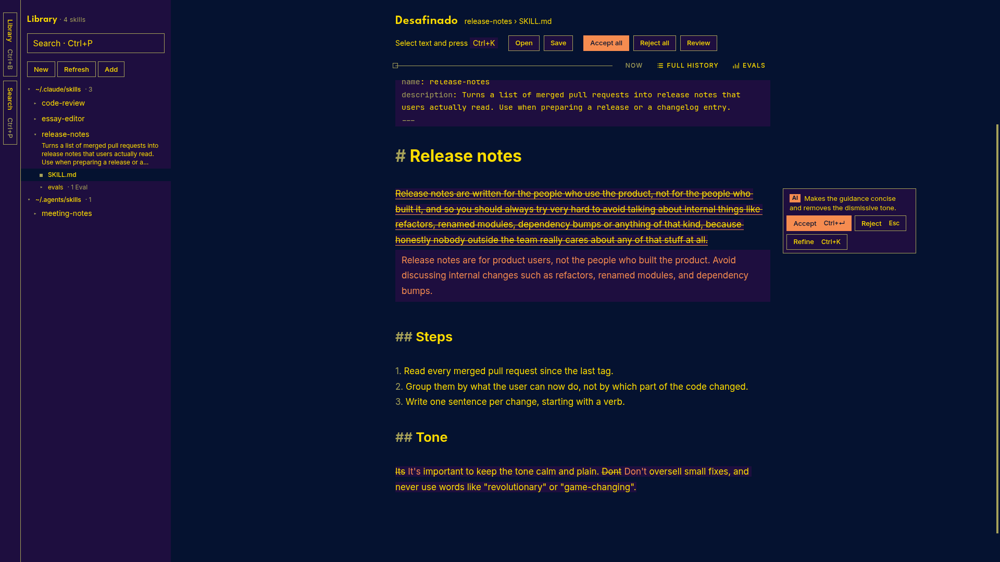

# Desafinado

A Markdown editor with an AI co-author, built for writing prose and agent Skills.

The name comes from Jobim's *Desafinado*, a song in defense of the singer who is slightly out of tune. The AI here proposes; your voice wins. Every change it suggests sits in the text as a tracked change until you Accept it.



## Writing with the AI

- **Ask about a passage.** Select text, or put the cursor in a paragraph, and press `Ctrl+K`. Pick a Quick action (Shorter, Clearer, Fix grammar, or one of your own) or type any Instruction.
- **Read the change in place.** The AI answers inline: the old text struck through, the new text beside it, and a one-line Rationale on a card in the margin. Small edits show a word-level diff; rewrites show the whole Block.
- **Decide.** Accept, Reject, or Refine ("shorter", then "now more formal"). The arrows on the card step between versions. Accept is a normal edit, so `Ctrl+Z` undoes it.
- **Review the whole Document.** A Review pass reads everything, optionally with a Focus ("tone only"), and streams up to six Suggestions, with Accept all and Reject all.
- **See how it got here.** The Timeline under the header keeps a Version after each Accept, Open, Restore and pause in your typing, marked by who made it. Full history shows every change, AI Rationales included, and any Version can be restored.

The AI has one visible identity: a caret in a single color, tagged "AI" with your Instruction, that travels to the passage it is working on. New text fades in, removed text is struck through, and accepted text fades into your own ink. Under the system's reduced-motion setting, all of it becomes plain color changes.

## Editing agent Skills

The desktop app is also an editor for the Skills your agents read (`~/.claude/skills`, `~/.agents/skills`, and project folders you add).

- **Library** (`Ctrl+B`): every Skill by its frontmatter name, with its files. **Library search** (`Ctrl+P`) finds Skills and files as you type.
- **Files on disk are the source of truth.** Save writes in place, atomically. When an agent, another editor or `git pull` changes the open file, Desafinado reloads it and records an External Version; with unsaved text, it asks first.
- **Evals.** The Evals page runs a Skill's Evals through the Claude CLI (`claude plugin eval`), with and without the Skill, and shows whether it helped. Needs the `claude` CLI, signed in.

## Two builds

| | Electron app | Web app |
|---|---|---|
| Run | `pnpm dev:electron`, or the installed package | `pnpm dev`, in a browser tab |
| Files | Native Open and Save; the open file reopens at start | File System Access in Chrome and Edge; a download elsewhere |
| History | `history.sqlite`, one per file, no cap | `localStorage`, one Document, 50 Versions |
| Library, Evals, external changes | Yes | No |

## Install and run

Needs Node 22.12 or newer, pnpm (pinned in `packageManager`; `corepack enable` installs it) and an [OpenRouter](https://openrouter.ai) API key.

```sh
cp .env.example .env     # then set OPENROUTER_API_KEY
pnpm install
pnpm dev:electron        # the desktop app
pnpm dev                 # or the browser app
```

- In dev, the key stays in `.env`. The app sends a placeholder, and the Vite proxy (`/api/openrouter/*`) sets the real `Authorization` ([ADR 0005](docs/adr/0005-local-only-vite-proxy.md)). A key exported in the shell wins over `.env`.
- `OPENROUTER_MODEL` is optional and defaults to `openai/gpt-6.1-terra`, picked by the [Bake-off](docs/bakeoff.md). Preferences can change it.
- Without a key, the app opens and says what is missing.

**Installed app (Linux).** `pnpm package` builds `release/desafinado-<version>.pacman`. It runs with no repo and no `.env`: you paste the key once in the app, and it lives in the system keyring. To make it the default for Markdown:

```sh
xdg-mime default desafinado.desktop text/markdown text/x-markdown
```

**Themes.** Preferences (`Ctrl+,`) offers 24 Palettes from *A Dictionary of Color Combinations*, named after Duke Ellington pieces, plus the original Desafinado theme. The default is Mood Indigo. On an [Omarchy](https://omarchy.org) machine, dev runs can follow the current Omarchy theme live. See [DESIGN.md](DESIGN.md).

## Keys

`Cmd` instead of `Ctrl` on macOS, except `Ctrl+H` / `Ctrl+L`.

| Key | Action |
|---|---|
| `Ctrl+K` | Ask about the selection, or the paragraph under the cursor. Inside a Suggestion: Refine it. |
| `Ctrl+Enter` | Accept the Suggestion under the cursor. |
| `Esc` | Close the bubble; cancel a request in flight; otherwise Reject the Suggestion under the cursor. |
| `Ctrl+H` / `Ctrl+L` | Previous / next version of a refined Suggestion. |
| `Tab` | Move into the bubble or the Active Suggestion's card; `Tab` and `Shift+Tab` cycle its buttons. |
| `Ctrl+Z` | Undo an Accept, or an Accept all in one step. Reject cannot be undone. |
| `Ctrl+O` / `Ctrl+S` / `Shift+Ctrl+S` | Open / Save / Save as. |
| `Ctrl+B` / `Ctrl+P` | Library / Library search (desktop app). |
| `Ctrl+,` | Preferences. |
| `←` / `→`, `Home` / `End` | On the Timeline: move between Versions. |

## Development

| Command | What it does |
|---|---|
| `pnpm test` | Vitest. Never calls the model. |
| `pnpm biome check` | Lint and format. |
| `pnpm build` | Type-check, then the Web build (`dist/`) and the Electron build (`out/`). |
| `pnpm preview:electron` | The built Electron app, as installed: `app://` scheme, key in the keyring, no Vite. |
| `pnpm package` | The Linux package. `package:dir` stops at the unpacked app. |
| `pnpm bakeoff` | Compares 9 models on the same requests and rewrites `docs/bakeoff.md`. Calls the model (about US$0.06). |

Before contributing, read [AGENTS.md](AGENTS.md): stack, code style, dev variables (`DESAFINADO_*`) and the definition of done. Names follow the [glossary](GLOSSARY.md); decisions live in [docs/adr/](docs/adr/).

## Next

From the [backlog](docs/BACKLOG.md):

1. **A sturdier Review prompt.** Moving one sentence made two Bake-off models return junk Replacements.
2. **Tabs**, once there is a design for more than one open Document.
3. **One window per file.** A second `.md` from the desktop replaces the open Document.
4. **Files other than Markdown.** Scripts and JSON in a Skill folder are listed, not opened.
