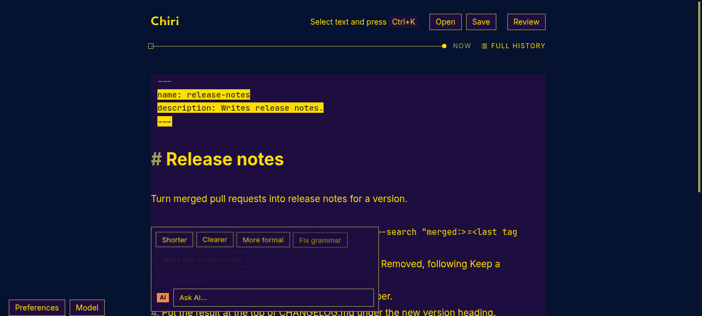
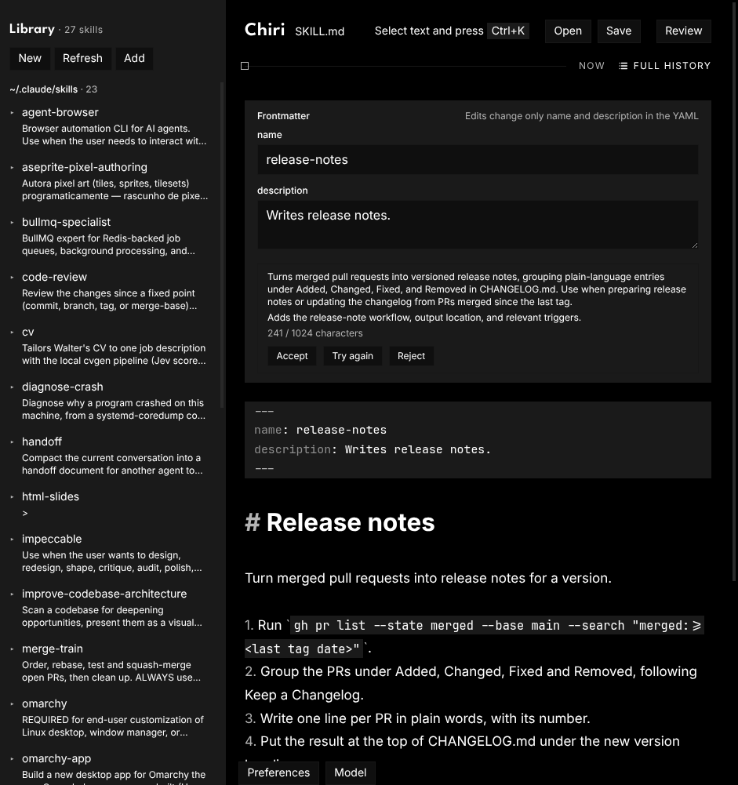

# Verification: Improve description prompt and selection on shaded lines

Issue [#72](https://github.com/walteraandrade/chiri-ai-editor/issues/72). Checked on 2026-11-07:
- **Web build:** `CHIRI_DEV_PORT=5317 pnpm dev` in `agent-browser`'s Chromium, theme `Mood Indigo`, a sample `SKILL.md` put into the editor through the view.
- **Electron build:** `CHIRI_DEV_PORT=5318 CHIRI_CDP_PORT=9318 CHIRI_USER_DATA_DIR=<temp dir> CHIRI_DEV_PICK_FILE=<temp file> pnpm dev:electron`, Omarchy theme. Open used `CHIRI_DEV_PICK_FILE` to load a temp `release-notes/SKILL.md`.

## Selection on frontmatter and code lines

The selection layer of CodeMirror sits behind the lines, so a line background hid it, and `--color-code-bg` is `--theme-selection`. Selected text now also gets a mark; on frontmatter and code block lines the mark inverts ink and canvas.

| Check | Result |
|---|---|
| `Mood Indigo` (selection, raised and code background all `#1e0e3f`): select from `name:` to the code block | Selected frontmatter and code text read `#ffdd00` background, `#051230` text ([72-1](img/72-1.png)) |
| Omarchy theme: select the frontmatter | Visible, inverted |
| `Mood Indigo`: select from a list item with inline code to inside a code block with an empty line | Inline code and the code lines read `#ffdd00` background; the empty code line shows an inverted block ([72-3](img/72-3.png)) |
| `Mood Indigo`: select from plain text across a Suggestion (struck-out and kept words), injected through the view with no model call | Selected text inside the Suggestion reads `#ffdd00` background, `#051230` text, also inside the struck-out `del` ([72-4](img/72-4.png)) |

## Improve description

| Check | Result |
|---|---|
| Description "Writes release notes." → Improve description | The proposal uses the body (CHANGELOG.md, Added / Changed / Fixed / Removed, last tag) and has a "Use when" sentence; 241 / 1024 characters shown ([72-2](img/72-2.png)) |
| Accept | Line 3 of the file becomes the new `description:` |

## AI calls

The call below used the first version of the prompt, which asked for what the skill does and when to use it. The maintainer then had it rewritten to ask only for when to invoke the skill; then had the examples removed, so the model would not copy their shape, which departs from the issue's "one or two examples". That version was checked in the two calls after it.

| Task | Model → provider | Tokens in / out / reasoning / cached | Cost (US$) | Latency client ms | Finish | Outcome | Generation |
|---|---|---|---|---|---|---|---|
| `SKILL.md` "Writes release notes." → Improve description, then Accept (first prompt) | `openai/gpt-6.1-terra` → OpenAI | 629 / 74 / 0 / 0 | 0.000999 | 3043 | stop | valid, 1 attempt | `gen-1794045689-XNusOADKEHUcvDPso9BP` |
| Same file, prompt without examples → Improve description, then Reject | `openai/gpt-6.1-terra` → OpenAI | 546 / 52 / 0 / 0 | 0.000806 | 2207 | stop | valid, 1 attempt | `gen-1794048184-2WhxK80OnLigL11V9r4P` |
| Same file, same prompt → Improve description, then Accept | `openai/gpt-6.1-terra` → OpenAI | 546 / 58 / 0 / 0 | 0.000836 | 2490 | stop | valid, 1 attempt | `gen-1794048195-Tokuw5FCztlRyFepbfBO` |

With the prompt without examples, the answer was: "Use when asked to write release notes or update CHANGELOG.md for a new version from merged pull requests, including requests to summarize changes since the last tag." (165 characters).

## Proposal motion

- Enter: the card has `unfold-in` (height from 0) and its box `surface-in`.
- Reject: 60 ms after the click the card had `unfold-out`, rows at 23.4 px and opacity 0.43; at 460 ms it was gone and the button was back.
- Accept, first build: the card stayed in `unfold-out` with no animation left, because the end event never reached React. A 400 ms fallback now clears it. My window stopped answering after a page reload, likely on a native unsaved-changes dialog, so the maintainer checked it in their own `pnpm dev:electron` window: after Accept the description changed, the card closed and the button came back.

OpenRouter `latency` and `generation_time` were not filled in the record when it was read.

Not checked: Try again (same path as the first ask), a body over 20,000 characters (cut with a note, covered by a unit test), a description in another language, and multiple selections in the browser.
