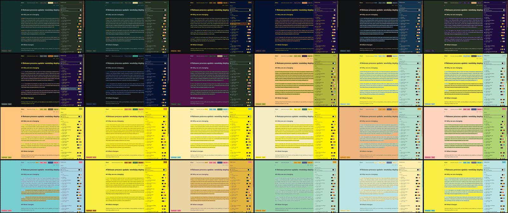

# Verification: theme system

Issue [#79](https://github.com/walteraandrade/chiri-ai-editor/issues/79), [ADR 0017](../adr/0017-book-themes-and-solid-colors.md). Checked on 2026-11-05 in both builds, since the change is shared renderer code plus both kits:
- **Web build:** `pnpm dev --port 5311 --strictPort` in `agent-browser`'s own Chromium, 1440 x 900.
- **Electron build:** `CHIRI_DEV_PORT=5313 CHIRI_CDP_PORT=9313 CHIRI_USER_DATA_DIR=<temp dir> CHIRI_DEV_PICK_FILE=<temp file> pnpm exec electron-vite dev --inspect 9329`, attached with `agent-browser connect 9313`.

Suggestions were injected through the suggestion effects in dev mode, so no check called the model.

## How the colors were checked

A script walked every visible element in the running app and read its computed text, background and border colors and its shadow. For each Palette it compared them against that Palette's codes, and it measured each text node against its background. All 24 Palettes went through every screen below. Each screen's presence was confirmed in a trial run, and Full history, the error text and the Key dialog again on every Palette.

| Screen | Build | Scans | Result |
|---|---|---|---|
| Main screen, Suggestions, Card, Preferences open | Web | 24 | Pass ([79-3](img/79-3.png), [79-4](img/79-4.png)) |
| Review popover, text selection, ask bubble, Toast, Full history | Web | 24 each | Pass ([79-6](img/79-6.png)) |
| Model dialog with an error ("Use an OpenRouter id such as provider/model.") | Web | 24 | Pass ([79-5](img/79-5.png)) |
| Library, New skill | Electron, dev | 24 each | Pass after a fix ([79-7](img/79-7.png)) |
| Preferences, Key dialog | Electron, built on `app://` | 24 each | Pass after a fix |

What the scans caught, all fixed and the affected case rescanned:
- The key hint inside Accept fell under AA in every theme (1.02 to 3.22).
- Disabled buttons fell under AA in `It Don't Mean a Thing` (4.18), on New skill and the Key dialog. They now have no fill and a dashed hairline, which also tells them from enabled buttons in every palette.
- One alpha reading on a Preferences row was the hover transition, in motion, so it was left alone.

Not scanned: the Leave dialog, the frontmatter panel, and hover states other than that one. They use the same tokens, and `src/theme/hard-rule.test.ts` covers their sources, but no one looked at them in each theme.

Sources: `src/theme/hard-rule.test.ts` (no `color-mix`, shadow, ring, alpha color or filter, with a positive control per pattern). Palettes: `src/theme/catalog.test.ts` against the book data (names, codes, sources, at least 6 colors, jobs, red, AI hue, AA, mode).

## Preferences

| Check | Build | Result |
|---|---|---|
| `Ctrl+,` opens it | Web | Pass |
| The `Preferences` button opens it, `Esc` closes it | Web | Pass |
| `File > Preferences…` opens it | Electron | Pass, clicked through `Menu.getApplicationMenu()` over the main process inspector, not with a mouse |
| The native menu keeps Edit, View and Window | Electron | Pass, read from the same inspector |
| `Ctrl+,` through the native accelerator, with a real key press | Electron | Not checked |
| Lists the Omarchy row (dev on this machine), the Chiri theme and 24 Palettes, with name, origin and colors | Both | Pass ([79-2](img/79-2.png)) |
| A click repaints at once | Both | Pass |
| The choice survives a reload (`chiri.theme`) | Web | Pass |
| The choice is stored | Electron | Pass; a restart was not tried |
| No choice stored: the Chiri theme, 25 rows, no Omarchy row, no prototype bar | Electron, built | Pass |
| The button can be clicked at 400 px wide, with and without the Missing key banner | Web | Pass, by hit test (the bar used to hide under 640 px, and the banner used to cover it) |
| The checked row takes focus on open | Web | Pass |

## Ellington credits

Titles were checked against secondary sources, not ASCAP or BMI: [Learn Jazz Standards](https://www.learnjazzstandards.com/blog/duke-ellington-songs/) for most, and Wikipedia or library catalogs for [C Jam Blues](https://en.wikipedia.org/wiki/C_Jam_Blues), [Azure](https://en.wikipedia.org/wiki/Azure_(song)), [Harlem Air Shaft](https://en.wikipedia.org/wiki/Harlem_Air_Shaft) and [Ko-Ko](https://keep.lib.asu.edu/items/5880). Pieces by Billy Strayhorn alone were left out. `Satin Doll` is credited to Ellington and Strayhorn.

## Review

First pass on three axes: Standards, Spec and TDD. Fixed from it:
- Boxes that vanished once every tint became the raised color: the Key dialog notice, the frontmatter proposal, unfocused inputs, the Timeline line (invisible on 12 palettes), Library rows.
- The Active Suggestion looked like the others in 19 palettes; it now has a 1px AI underline.
- `focus-visible:ring-1` in the Key dialog was a box-shadow, and `hover:brightness-110` on the problems badge was a filter.
- The Preferences button hid under 640 px.
- `themeLabel` cases I had dropped are back; the kit's pass-through, the dark red fallback and the variable names now have real tests; the hard-rule patterns got wider, with positive controls.
- `README.md`, `DESIGN.md` and the Chiri and Omarchy rows, which showed only some of their colors.

Kept, with the reason:
- `Menu` closes over the first window: on Linux, closing it quits the app, so there is no second one.
- `pnpm dev` follows Omarchy when nothing is stored, and the issue says the Chiri theme is default: this behavior is older, dev only, and the built app was checked to use the Chiri theme.
- The Omarchy test recomputes `mixHex` values: the ratios are design values, and `mixHex` has its own tests.
- The bubble's orbit and the sweeps pass through in-between tones: they are motion, which the ADR allows.
- The relay in the preload repeats `onLaunchFile`: one more copy did not earn a helper.

Second pass, on those fixes. Fixed from it:
- Disabled buttons looked enabled in several palettes, since faint can equal ink or accent.
- The Missing key banner covered the bottom bar. The bar and the banner now stack.
- `src/theme/hard-rule.test.ts` could pass on an empty file list, and it missed `text-shadow`, `filter` and partial `opacity` at rest in the stylesheets.

## Open for the maintainer

- The default theme, and whether the Chiri theme stays.

## AI calls

None.
