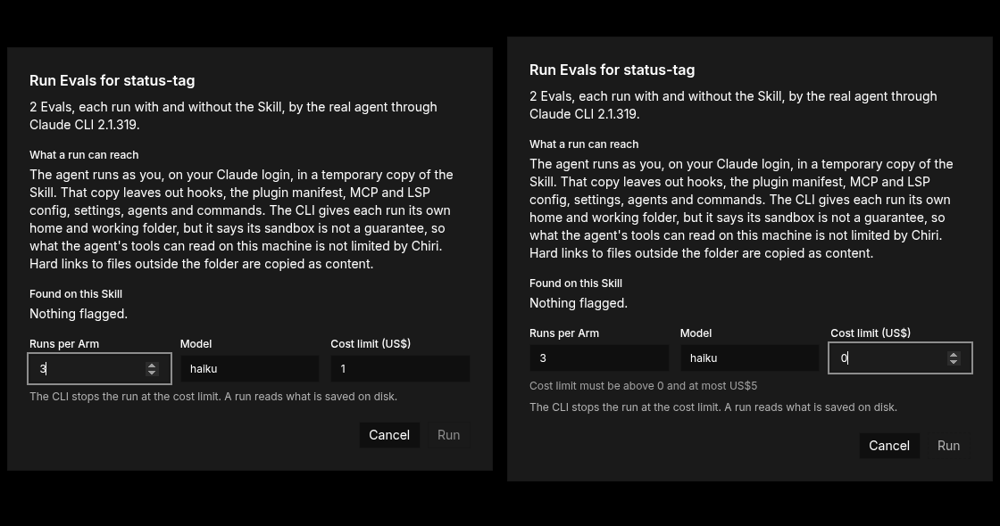
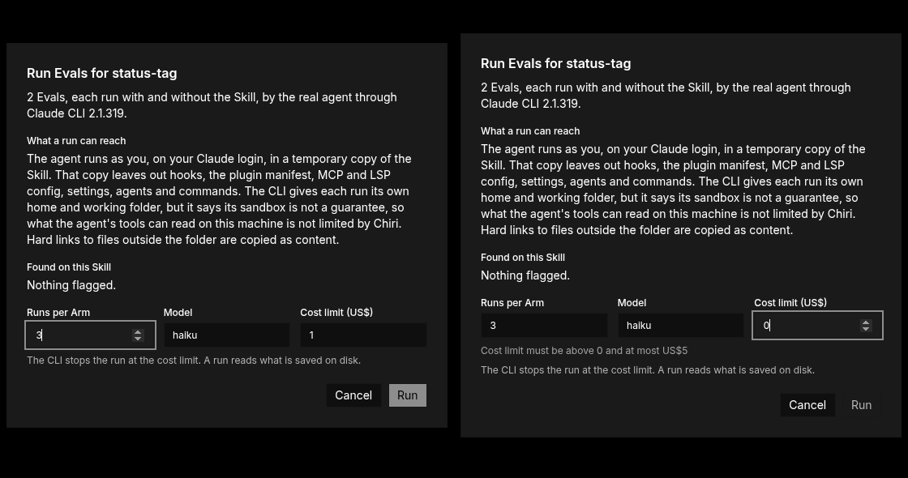
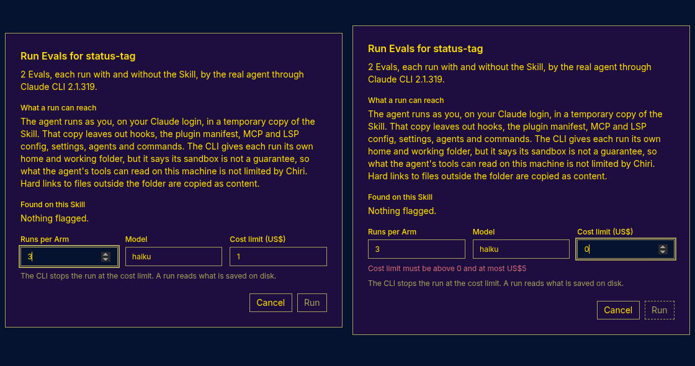
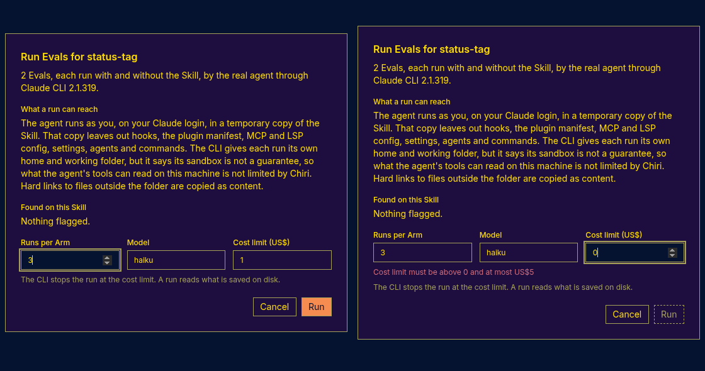

# Verification: Eval run

Issue [#87](https://github.com/walteraandrade/chiri-ai-editor/issues/87), [ADR 0018](../adr/0018-skill-evals-through-claude-cli.md). Checked on 2026-11-07 in the Electron build: `CHIRI_DEV_PORT=5387 CHIRI_CDP_PORT=9387 CHIRI_USER_DATA_DIR=<temp dir> CHIRI_DEV_PICK_FILE=<file> pnpm dev:electron`, attached with `agent-browser connect 9387`. Claude CLI 2.1.319, model `haiku`.

**Checks that used `CHIRI_DEV_PICK_FILE`:** only adding the throwaway skill folder to the Library (Add). Nothing else used it.

The throwaway skill `gate-skill` lived in the session scratchpad, with `hooks/hooks.json` (a `SessionStart` hook that touches a marker file) and two Evals: `greet` (regex `PINEAPPLE`) and `read-outside` (the agent Reads a sentinel file outside the run's temporary folders; graders: `Read` was used, and the sentinel text appears in the trace).

| Check | Result |
|---|---|
| The panel shows under the open Skill in the Library, with "No complete run yet" and Run Evals ([87-1](img/87-1.png)) | Pass |
| Run Evals stages, then the dialog names the Skill, the case count, the CLI version, what a run can reach, the risks (`The Stage leaves out: hooks`), runs, model and cost limit ([87-2](img/87-2.png)). It does not call the run isolated | Pass |
| Run with runs 1, model `haiku`, cost limit 0.3: the panel shows Running, then the last complete run: `greet` 1/1 with, 0/1 without; `read-outside` 0/1 and 0/1; All 1/2 and 0/2; cost about US$0.0061 ([87-3](img/87-3.png), [87-4](img/87-4.png)) | Pass |
| Open report opens the CLI's `report.html` from `<userData>/eval-runs/<hash>/last/report/` with no error | Pass |
| Results are in `<userData>/eval-runs/<hash>/last/`; `next/` is gone | Pass |
| No `chiri-eval-*` Stage folder is left in the temp directory after the run | Pass |
| **Open check 1:** after the run from the app, the `SessionStart` marker file is absent. The orchestrator's spike showed the same command on the real folder creates it | Pass |
| **Open check 2:** `Read` was called in both Arms (`read-called` passed), and the sentinel text is not in either trace (`trace-has-content` failed in both), so the content did not reach the trace | Pass |

Both open checks hold on this machine and this CLI version, for one outside file under the scratchpad. That is not proof that a `Read` reaches nothing: the dialog says Chiri does not limit what the agent's tools can read.

## Runs

| Run | Model | Cost (US$, CLI's `costUsd`) |
|---|---|---|
| Fixture, 1 case, from a shell (recorded as `src/evals/fixtures/with-without.json`) | `haiku` | 0.00265 |
| From the app, 2 Evals, 1 run, with and without | `haiku` | 0.00613 |

The fixture run is also in [ai-costs.md](../ai-costs.md#eval-runs). A first fixture attempt with a fake `HOME` hit `auth_failed` (cost 0); its shape is the basis of `src/evals/fixtures/auth-failed.json`. Total spend of this slice's checks: about US$0.009.

## Review question: project config in the Stage

The Stage keeps `.claude/` and `CLAUDE.md`, since ADR 0018 does not list them. Checked from a shell, with the command line of `command.ts` and `--ablation none`: a Stage holding `.claude/settings.json` with `SessionStart` and `PreToolUse` hooks that touch a marker, and a `CLAUDE.md` asking for a marker word in every reply. The hook marker was absent and a regex grader for the word failed, so neither loaded. One run, `haiku`, CLI 2.1.319, US$0.0018. This matches the CLI docs: no `.claude/` or `CLAUDE.md` loads from above the workspace or inside it.

## Review fix: the Run button

In the Omarchy theme (vantablack) the enabled Run looked disabled: its fill matched the dialog and its text (`accent` #8d8d8d) was darker than the disabled text (`faint` #b3b3b3). In Mood Indigo both states had the same text color. Run now uses `cm-ai-button-primary` (16a3fa1). Checked on 2026-11-08 under Xvfb, at 96cf79e (before) and 16a3fa1 (after); each image is enabled on the left and disabled (cost limit 0) on the right.

| Theme | Before | After |
|---|---|---|
| Omarchy (vantablack) |  |  |
| Mood Indigo |  |  |
