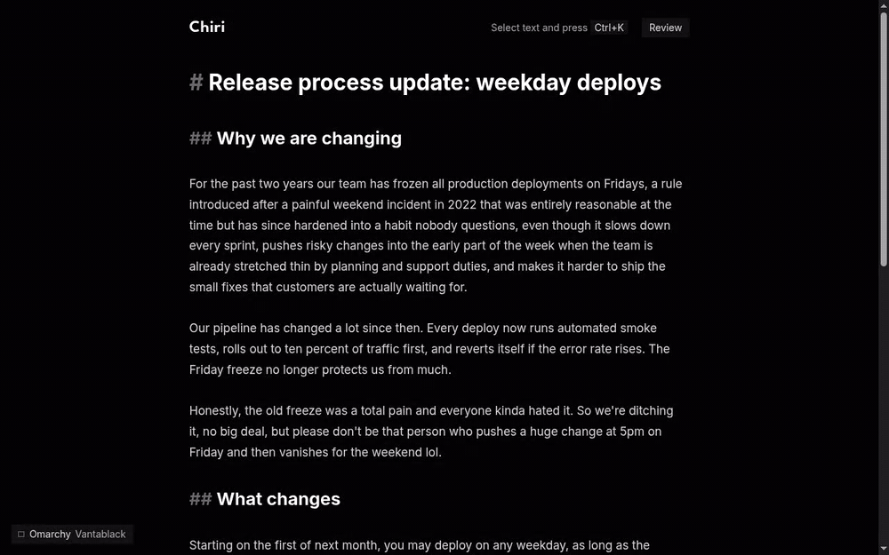

# Verification: AI motion and the Omarchy theme

No issue: a polish pass asked for by the maintainer. Built first on `main`, then moved onto `feat/open-save-markdown` (`main` is frozen for the assessment, [AGENTS.md](../../../AGENTS.md)). Checked on 2026-11-02 in both builds ([ADR 0016](../adr/0016-web-and-electron-builds.md)), since the change is shared renderer code:
- **Web build:** `pnpm dev --port 5199` in `agent-browser`'s own Chromium, 1440 x 900.
- **Electron build:** `CHIRI_DEV_PORT=5305 CHIRI_CDP_PORT=9305 CHIRI_USER_DATA_DIR=<temp dir> pnpm dev:electron` inside `gamescope --backend headless`, attached with `agent-browser connect 9305`, 1280 x 831.

Every Suggestion and the Review pass were injected through the suggestion and review effects in dev mode, so no check called the model. The checks in the first table ran on `main` and were repeated on the new base where marked.



## Maintainer decisions

Taken before building, through the `impeccable` skill's interview:
- Motion: expressive co-author (an AI caret that travels, a word-by-word reveal, an animated border while you ask), with a calm, precise personality: expo-out easing, no bounce, no sparkle.
- Omarchy: live, light and dark. `pnpm dev` and `pnpm dev:electron` read the current theme and follow theme switches; a light Omarchy theme renders light. This lifts the "dark theme only" line in [AGENTS.md](../../../AGENTS.md); Chiri's own theme stays dark and is the default everywhere else.
- `PRODUCT.md` and `DESIGN.md` are committed at the root as the context for later design work.

## What was built

- **Theme seeds.** Every color derives from 8 seeds on `:root` (`--theme-*`) with `color-mix()`. AI surfaces get their own tokens (`--color-ai`, `-ai-text`, `-ai-tint`, `-ai-wash`, `-ai-glow`, `-ai-ink`).
- **Omarchy plugin** ([config/omarchy-theme.ts](../../../config/omarchy-theme.ts)), registered in [config/renderer.ts](../../../config/renderer.ts) so both dev servers have it. Reads `~/.local/state/omarchy/current/theme/colors.toml` into a virtual module, watches `theme.name` (written last by `omarchy-theme-set`) and pushes the new theme over Vite's HMR socket. A build gets `null`, so no local theme is baked into `dist/` or `out/`, and the installed app uses the Chiri theme.
- **AI caret** ([src/editor/ai-caret.ts](../../../src/editor/ai-caret.ts)). Shown only while the AI works. A Refine wins over a pending request; a request wins over a Review pass.
- **Moments** ([src/editor/motion-field.ts](../../../src/editor/motion-field.ts)). A short-lived record of "revealed", "landed" and "settled", built from state transitions and expired by timers. Entrance animations hang on it rather than on DOM creation, because CodeMirror rebuilds marks often and a CSS animation would replay on each rebuild.

## What was checked

| Check | Result | Evidence |
|---|---|---|
| Bubble: chips rise in a stagger; with `Ctrl+K` an Ember arc orbits the border | Pass | `getAnimations()` on the bubble: `cm-ai-orbit: running` while the input has focus ([ai-motion-1](img/ai-motion-1.png)) |
| A request shows the AI caret with its Instruction at the end of the Target | Pass | Caret `is-visible`, label "More formal", over the pending wash ([ai-motion-2](img/ai-motion-2.png)) |
| A Replacement fades in word by word; the strike is drawn | Pass | Three frames, about 0 / 150 / 1200 ms ([ai-motion-3](img/ai-motion-3.png)) |
| Accept lands in the AI color, then fades to ink | Pass | Sampled color: AI text until about 300 ms, ink at about 82% alpha by 1.2 s, mark gone at 1.5 s ([ai-motion-4](img/ai-motion-4.png)) |
| Reject settles | Pass | `.cm-ai-settled` present at 50 ms, gone at 850 ms |
| Typing right after Accept ends the landing instead of replaying it | Pass | Unit test, `motion-field.test.ts` |
| Review pass: the caret starts at the top and hops to each Suggestion | Pass | Caret transform sampled every 300 ms: (0, 16) → 423 → 551 → 553 (gliding) → 366 → 309 → … → (517, 1332); toolbar shows the AI pulse and "Reviewing… 3 suggestions" |
| Refine: the caret shows the Refine Instruction; the new version reveals again | Pass | Caret "Warmer, keep it short", 2 refining marks, then 9 revealing words and "2 / 2" |
| Omarchy theme: toggle, remembered choice | Pass | `aria-pressed="true"`, `localStorage['chiri.theme'] = 'omarchy'`, body `rgb(0, 0, 0)` on Vantablack ([ai-motion-5](img/ai-motion-5.png)) |
| Light theme | Pass | Catppuccin Latte tokens applied through `applyTheme`: `data-theme-mode="light"`, hierarchy holds ([ai-motion-6](img/ai-motion-6.png)) |
| Live theme push | Pass | `touch ~/.local/state/omarchy/current/theme.name` → a probe listener got `chiri:omarchy-theme` with `vantablack` |
| Reduced motion | Pass | Emulated `prefers-reduced-motion`: caret transition 1 ms, no animation on its bar, pending shows a still AI glow |
| Phone width (390px) | Pass | No horizontal scroll (`scrollWidth` 375); the theme button is hidden below `sm` ([ai-motion-7](img/ai-motion-7.png)) |
| The build has no theme in it | Pass | `grep vantablack dist/assets/*.js` finds nothing |

Before: [ai-motion-0](img/ai-motion-0.png).

### On `feat/open-save-markdown`

| Check | Build | Result | Evidence |
|---|---|---|---|
| Request → AI caret → reveal → Accept → landing | Web | Pass | Sampled every 200 ms: caret on until the Replacement, then 10 revealing words and a drawn strike for about 1.1 s |
| Same | Electron | Pass | Sampled every 250 ms: caret on for 1 s, 10 revealing words, then `.cm-ai-landed` for 1.5 s after Accept |
| Review pass: the caret hops and hides at the end | Electron | Pass | (0, 16) → (330, 386) → (377, 438) → (319, 753) → … → (517, 1273) → hidden ([ai-motion-8](img/ai-motion-8.png)) |
| One Review button across the pass (#26), now with the AI pulse and count | Electron | Pass | The same `<button>` before and during the pass (`===`), `aria-busy="true"`, the AI pulse inside, label "Reviewing… 3 suggestions Stop" |
| Omarchy theme: toggle, remembered, live push | Electron | Pass | Click: body `rgb(20, 20, 23)` → `rgb(0, 0, 0)`, `chiri.theme = omarchy`; `touch theme.name` → `chiri:omarchy-theme` with `vantablack` |
| The theme button never covers the Library or the text | Electron | Pass | Sticky in the editor column: right edge 401 px, text starts at 417 px, Library ends at 288 px |
| Every Tailwind color class in use has a token | Both | Pass | A scan of `bg-`/`text-`/`border-`/… classes and `var(--color-…)` against `src/index.css`: nothing missing |
| No theme baked into either build | Both | Pass | `grep vantablack dist out` finds nothing |

Found and fixed when moving the base:
- `src/main.tsx` was split into `main.web.tsx` and `main.electron.tsx` upstream. The initial theme is applied in [src/platform/mount.tsx](../../../src/platform/mount.tsx), which both entries share.
- The History and Library UI use `bg-surface`, `bg-accent-tint` and `text-accent-soft`, which the first version of this change had removed: the Library, the key dialog and the Timeline's selected dot lost their colors with no error. The three tokens are back, derived from the seeds.
- The fixed bottom-left theme button sat on top of the Library's list in the Electron build. It is now sticky in the editor column and reads only "Omarchy"; the theme's name is in its tooltip.
- From the maintainer's own check in the Electron build: the open file was not visible in the Library under Vantablack (a 12% tint of a gray accent on black), and the native scrollbar with arrow buttons clashed with the UI. The open file now has a 20% accent row, medium-weight ink and a solid accent square, and its skill an accent caret; scrollbars are thin, themed and have no arrows ([ai-motion-9](img/ai-motion-9.png), Vantablack left, Chiri right).
- `pnpm install` in this worktree linked `electron` without its binary (`Error: Electron uninstall`); `node node_modules/electron/install.js` restored it from the local cache. Not a project change.

Found and fixed during the check:
- On a monochrome theme (Vantablack) the AI-colored Accept text was dimmer than Reject. Primary buttons now use strong ink on an AI tint.
- The theme button in the header wrapped the toolbar onto a third line during a Review pass. It moved to the bottom-left corner, with a solid backdrop.
- The bubble input showed the focus outline on top of the orbiting border. Inside the bubble the border is the focus signal; the Refine input keeps its outline.

Not checked:
- A real switch of the system theme. The check did not change the maintainer's desktop theme: the live path was checked with `touch` (same theme), and the light theme by applying its tokens in the page.
- A check with real model calls. The motion reads the same state the model fills, so injected Suggestions exercise the same code; a maintainer check with the model is still open.

```text
On feat/open-save-markdown, after the review:
tsc (web and Electron)  no errors
pnpm test               154 files, 2598 tests passed
pnpm biome check        395 files, no diagnostics
pnpm build              green (Web and Electron)
```

## Review

One pass with three parallel reviewers (Standards, Spec, TDD), against `origin/feat/open-save-markdown`.

Fixed:
- **CodeMirror stayed in dark mode under a light theme** (`{ dark: true }` in the editor theme). [src/editor/theme-mode.ts](../../../src/editor/theme-mode.ts) now follows `data-theme-mode`: checked in the page, `darkTheme` true → false under Latte → true again.
- **Reduced motion hid the hand-over.** Landed text now shows in the AI color, still, for the moment's 1.5 s; rejected text shows a still neutral fill. Checked: AI text color at 300 ms, gone at 1.7 s.
- **Contrast:** deleted text and key hints move from faint (about 3.5:1) to muted ink, for WCAG AA.
- **DESIGN.md kept:** the toast gets the float hairline and shadow (one `--shadow-float` token for every floating surface); the settle runs 420 ms; the target preview goes back to the accent tint, since the text is still the writer's; the landing gets the soft glow the request asked for.
- **ADR 0004:** the bubble's field says "Ask AI…" again.
- **Library:** a collapsed skill that holds the open file gets a light accent row too.
- **Structure:** `aiFlag` in its own module; the theme no longer imports from `ui/` (`activeTheme` and `applyInitialTheme` live in `src/theme/`); `revealParts` is a pure, linear, tested function; the expiry timers are a tested `createExpiryScheduler`; clearer names (`newlyRevealedIds`, `travelFrom`, `flagOnLeft`, `hasOpenFile`); one pair of shared entrance keyframes instead of five near-copies.
- **Tests added:** the plugin serves the theme in dev and `null` to a build; `readOmarchyTheme` on real files; explicit `mode` against the background, short hex; `activeTheme`; the decorations' entering, landed and settled classes; the scheduler with fake timers; an empty Replacement lands nothing; the newest Review Suggestion above the last one; a request over a Review pass; the caret leaving when the pass ends.

Kept, with the reason:
- The extras the request did not name (the theme button, the primary Accept, the Review pulse and count, the AI tag, the theme crossfade) were all seen and kept by the maintainer during the check.
- The caret hides when its position is outside CodeMirror's rendered range; following it there would mean scrolling for the writer.
- In Omarchy themes the AI color is the theme's accent, as DESIGN.md says; a theme whose `red` is gray (Vantablack) shows errors in gray.
- TS durations (`MOMENT_DURATION_MS`) still mirror the CSS ones, with a margin; the unused `--motion-word-budget` token is gone.

## AI calls

None. Every Suggestion in these checks was injected through the effects in dev mode.

## Screenshots

| File | What it shows |
|---|---|
| [ai-motion-flow.gif](img/ai-motion-flow.gif) | The whole flow, about 19 s |
| [ai-motion-0](img/ai-motion-0.png) | Before: a Suggestion with its margin Card |
| [ai-motion-1](img/ai-motion-1.png) | The bubble asking, with the AI tag and the orbiting border |
| [ai-motion-2](img/ai-motion-2.png) | A pending request with the AI caret |
| [ai-motion-3](img/ai-motion-3.png) | The reveal, three frames |
| [ai-motion-4](img/ai-motion-4.png) | The landing after Accept, three frames |
| [ai-motion-5](img/ai-motion-5.png) | The Omarchy Vantablack theme |
| [ai-motion-6](img/ai-motion-6.png) | The Catppuccin Latte (light) theme |
| [ai-motion-7](img/ai-motion-7.png) | Phone width |
| [ai-motion-9](img/ai-motion-9.png) | The Library with an open `SKILL.md`, Vantablack and Chiri, with the themed scrollbar |
| [ai-motion-8](img/ai-motion-8.png) | The Electron build during a Review pass, with the Library and the theme button beside it |
